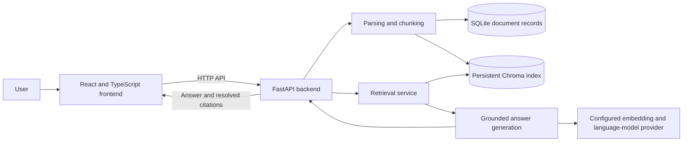

# Planned Architecture

> This describes the intended design. The application components and data flow below are not implemented yet.

## Responsibilities and boundaries

- The frontend presents the document library, processing status, questions, answers, and citations. It communicates with the backend over HTTP and does not access storage or model providers directly.
- The FastAPI layer validates requests and formats responses. Parsing, retrieval, and answer-generation logic belong in separate backend services.
- Parsing and chunking preserve document identity and page or section provenance where available.
- SQLite is the source of truth for document records and processing status. Chroma stores searchable vectors and chunk metadata; it is not the document registry.
- Retrieval results retain stable document and chunk identifiers so citations can be resolved from actual source records.
- Model-provider credentials remain on the backend. If a hosted provider is configured, questions and relevant retrieved excerpts may leave the computer; the provider has not yet been selected.
- Local documents and runtime data remain under `data/` and are excluded from version control. The exact configurable runtime-data location will be established during implementation.

## Planned question flow

1. The user uploads a supported document through the frontend.
2. The API validates it; backend parsing and chunking retain its source metadata.
3. Document status is recorded in SQLite and searchable chunks are stored in persistent Chroma.
4. The user submits a question. Retrieval selects relevant chunks from the local index.
5. Answer generation receives the question and bounded evidence, then returns an answer or an insufficient-evidence response.
6. The API resolves citations against retrieved source records and returns them with supporting excerpts.